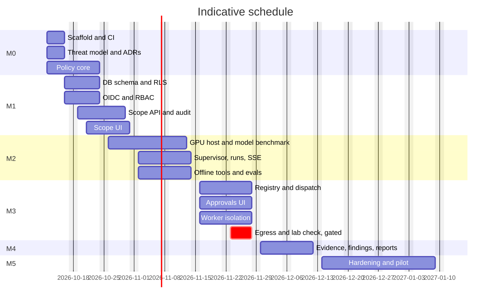

# Tatvam AI Red Team: Delivery Plan

**Source of truth:** [`docs/spec/TATVAM_AI_RED_TEAM_IMPLEMENTATION.md`](spec/TATVAM_AI_RED_TEAM_IMPLEMENTATION.md) (v1.0, sha256 `20d00e94cec2b131305cb919d01bd97d46293b206660425eacdf259255e53e52`).
This plan sequences that spec. Where the two disagree, the spec wins and this plan is corrected.

**Plan date:** 2026-10-10. **Indicative start:** Monday 2026-10-12. Dates assume a small experienced team, as the spec does (section 12).

---

## 0. Starting state

| Item | State | Action |
|---|---|---|
| Remote `tatvama/red-team` | **Public**, all branches pushed 2026-10-10 at the owner's request | Revisit visibility before any engagement data exists (risk R1) |
| Local clone | `D:\Projects\red-team`, bootstrap on `main` | Pushed with the three slice branches |
| Node | v24.15 | OK |
| pnpm | Missing | `corepack enable pnpm` |
| Python | Missing | Install `uv`, then `uv python install 3.12` |
| Docker | Missing | Docker Desktop with WSL2 backend, or develop inside WSL2 Ubuntu |
| GPU host | Not provisioned | Not needed until M2. CI uses a mock LLM client |

---

## 1. Guardrails that shape every task

These come from spec sections 1.3, 1.4, 3.1 and 11. Each one is enforced in code and tests, never by prompt.

1. **Authorization is a reviewed scope record.** Chat, LLM output, MCP responses and tool output never grant anything.
2. **Default deny.** Missing, expired, unreviewed or revoked scope blocks every target-contacting tool.
3. **Policy is pure deterministic code.** `policies/` cannot import an LLM client, agent code or network libraries. Agents cannot write approvals.
4. **One path to a target:** typed tool request, Policy Decision Point, single-use approval bound to the payload hash, recheck at worker start, short-lived capability, destination-enforcing egress proxy.
5. **Not built in MVP, in any milestone of this plan:** exploitation, credential attacks, evasion, persistence, lateral movement, exfiltration, arbitrary shell, broad internet scanning, destructive testing.
6. **Network tools stay disabled** (`AUTO_TARGET_ACTIONS_ENABLED=false`) until M3 egress and denial tests pass.
7. **Every PR tests both the success path and the denial path.**

---

## 2. Branch and worktree strategy

- **`main`** is the integration branch. Protect it: PR required, CI green, one approving review.
- **Sensitive paths** need a second review from a named security reviewer via `CODEOWNERS`: `services/api/app/policies/`, `tools/`, `workers/`, `auth/`, `infra/gateway/`, any compose file and any Dockerfile.
- **Branch names:** `feat/m<N>-<slice>`, `docs/<topic>`, `fix/<topic>`, `sec/<topic>`.
- **One worktree per active stream**, as siblings under `D:\Projects\red-team-worktrees\`. Sibling folders keep nested checkouts out of ruff, eslint and pytest discovery in the main checkout.
- **One worktree is one vertical slice is one PR.** After merge, remove the worktree and delete the branch.
- **Parallel AI sessions:** open each worktree folder as its own Claude Code session and give it the matching prompt from spec section 15.

### Worktrees created at bootstrap

| Folder | Branch | Slice | Owns these paths |
|---|---|---|---|
| `red-team-worktrees/m0-scaffold` | `feat/m0-scaffold` | Monorepo tooling, CI, dev compose without workers | Root configs, `apps/web`, `services/api` skeleton, `infra/compose.dev.yaml`, `.github/` |
| `red-team-worktrees/m0-threat-model` | `docs/m0-threat-model` | ADRs, threat model, trust diagram, control matrix, authorization template | `docs/` only |
| `red-team-worktrees/policy-core` | `feat/policy-core` | Pure Policy Decision Point and the unit tests in spec 13.1 | `services/api/app/policies/`, `tests/unit/policies/` |

**Why start the policy core now.** It is the highest-risk component, it has no infrastructure dependency, and its tests are fully named in spec 13.1. It rebases onto `feat/m0-scaffold` after that merges, to pick up `pyproject.toml` and CI.

### Worktree commands

```bash
# create a new slice from latest main
git -C /d/Projects/red-team fetch origin
git -C /d/Projects/red-team worktree add ../red-team-worktrees/m1-db-schema -b feat/m1-db-schema main

# list, then clean up after merge
git -C /d/Projects/red-team worktree list
git -C /d/Projects/red-team worktree remove ../red-team-worktrees/m1-db-schema
git -C /d/Projects/red-team branch -d feat/m1-db-schema
```

---

## 3. Decisions to make (spec section 17)

| # | Decision | Recommendation | Needed by | Owner |
|---|---|---|---|---|
| D1 | Host provider and terms | Shortlist two B200 providers whose acceptable-use policy permits authorized security testing. Confirm nested virtualization, disk persistence on stop, egress rules and stop-billing | Before M2 | Platform lead |
| D2 | Identity provider | Keycloak in dev compose for M1 so auth tests are repeatable with MFA. Switch to company OIDC by config later | M1 start | Security lead |
| D3 | Authorization evidence | Name who signs customer scopes. Enforce `scope_reviewer` as a different user from the scope author | M1 start | Security lead and legal |
| D4 | Model | Benchmark two or three open-weight candidates with suitable licenses on tool-call schema validity and the refusal-boundary fixtures. Record the result as an ADR | M2 week 1 | AI/ML lead |
| D5 | Worker isolation | Use a microVM such as Firecracker or Kata if the provider allows nested virtualization. Otherwise use network-disabled containers with offline tools only, and keep target tools off | M3 start | Platform and security |
| D6 | Backup destination | Encrypted off-host bucket under a separate provider account. Restore drill before the first lab engagement | Before M3 lab work | Platform lead |
| D7 | Permitted targets | An intentionally vulnerable app you deploy yourself in an isolated lab network, plus one authorized staging environment | M3 | Security lead |
| D8 | Retention | Make every period configurable. Fill in values once contract terms are known | M4 | Legal |
| D9 | Repo visibility | Private until pilot sign-off (see R1) | Before first push | Repo owner |

Defaults chosen for M0 unless someone objects: Python 3.12 with `uv`, Node 24 with pnpm workspaces, GitHub Actions on `ubuntu-latest`.

---

## 4. Milestones

### M0: Foundation and threat model (Oct 12 to Oct 15), spec Prompt A

**`feat/m0-scaffold`**
- pnpm workspace with `apps/web` (Next.js App Router, TypeScript strict, Tailwind, shadcn/ui, ESLint, Vitest) and `packages/contracts`.
- `services/api` as a `uv` project: FastAPI, Pydantic v2, SQLAlchemy 2, Alembic init, ruff, mypy strict, pytest. Liveness endpoint only.
- `infra/compose.dev.yaml` with Postgres plus pgvector, Redis, MinIO and Keycloak, all on pinned tags. No vLLM locally and **no tool workers**.
- pre-commit hooks: ruff, eslint, prettier, gitleaks, whitespace fixers.
- CI: lint, type-check and test for both languages, gitleaks, dependency review. Lockfiles committed.
- OpenAPI export script feeding generated TypeScript types in `packages/contracts`.

**`docs/m0-threat-model`**
- `docs/threat-model.md` using STRIDE over the six trust boundaries in spec 11.1.
- Dataflow and trust-boundary diagram in Mermaid.
- Control matrix mapping each invariant to its control and test. It seeds section 5 of this plan.
- Formal forbid-list from spec 1.4, ready for sign-off.
- Engagement authorization template.
- ADRs: monorepo layout, policy as a pure module, Hybrid-first, single-host isolation caveat, OIDC choice, SSE over WebSocket, outbox-based dispatch.

**Exit:** every external dataflow documented; forbid-list approved by the security lead; CI rejects a failing test and a planted fake secret.

### M1: Database, identity, scope (Oct 16 to Oct 30), spec Prompt B

| Slice | Work |
|---|---|
| `feat/m1-db-schema` | Alembic migration of the spec section 5 DDL, ORM models, lab tenant seed, row-level security on tenant tables, migration up and down test |
| `feat/m1-auth` | OIDC JWT checks on `iss`, `aud`, `exp` and `kid`, algorithm allowlist, JWKS cache with a staleness limit, tenant middleware, RBAC dependency, `/auth/me`, Keycloak dev realm with one test user per role |
| `feat/m1-scope-api` | Engagement CRUD, immutable scope versions, submit, approve and revoke, the state machine in spec 4.2, reviewer separation, revoke cascade, hash-chained audit events, `Idempotency-Key`, the error format in spec 6.1 |
| `feat/m1-web-scope` | Login, projects, engagement wizard, scope diff, review and revoke pages using TanStack Query, Zod and generated types |
| `feat/policy-core` | Canonicalization, scope validity, dot-boundary DNS suffix match, CIDR match, limits that only tighten, the three-value decision, forbidden categories always denied |

**Tests:** scope expiry, tenant escape, same-user reviewer, revoked scope, OIDC and JWKS verification, row-level security.
**Exit:** no code path reaches a target-contacting action without an approved scope; scope review is independently audited.

### M2: Hybrid agent core (Nov 2 to Nov 13), spec Prompt C

The GPU host can be provisioned in parallel from late M1, following spec 10.1 steps 1 to 7.

| Slice | Work |
|---|---|
| `infra/m2-vllm` | Provisioning scripts, vLLM launch config, benchmark harness at 4k, 16k and 32k context for tool-call validity and parallel requests, model ADR |
| `feat/m2-supervisor` | LangGraph graph from spec 7.2, Postgres checkpointer, state contract from 7.3, budgets, interrupt path |
| `feat/m2-runs-api` | Run create, pause, resume and cancel, SSE with `Last-Event-ID`, task list |
| `feat/m2-offline-tools` | `lookup_advisory` against a local advisory mirror or a single allowlisted source, and `semgrep_review` on authorized repo assets with pinned rulesets |
| `feat/m2-evals` | Prompt-injection and scope-override fixture corpus from spec 13.3 and 13.5 |

**CI without a GPU:** a mock LLM client implements the same interface with recorded responses, so tests stay deterministic. If the model service is down, runs pause. They never fall back to an external API.
**Exit:** an offline repository review run produces a report; injected tool output cannot grant new tool permissions.

### M3: Tool gateway and explicit approval (Nov 16 to Nov 27), spec Prompts D then E

| Slice | Work |
|---|---|
| `feat/m3-registry` | `ToolDescriptor` and `ToolAdapter`, strict schemas that forbid extra fields, canonical JSON with SHA-256, idempotency keys |
| `feat/m3-dispatch` | The dispatch guard from spec 7.4 with row locks and an outbox, worker-start recheck, atomic approval consumption, short-lived capability bound to run, scope version, target, action, parameters, worker and expiry |
| `feat/m3-approvals-ui` | Approvals list, detail and decision, payload hash display, change diff, required reason, expiry |
| `feat/m3-worker-isolation` | Worker with no network by default, non-root, read-only root filesystem, all capabilities dropped, `no-new-privileges`, seccomp, resource limits. A simulated adapter comes first |
| `feat/m3-egress` (gated) | Destination-enforcing egress proxy, re-resolve and check IP before connect, no redirect following, normalization tests, then `inspect_http_headers` against one fixed lab asset |

**Gate for `feat/m3-egress`:** it starts only after the denial, redirect, DNS, replay and revocation tests pass. If the chosen host cannot demonstrate egress enforcement, the feature stays disabled and the blocker is documented.
**Exit:** denied target, redirect, DNS and replay tests pass; an approved action executes exactly once; a rejected action never executes.

### M4: Findings, evidence, reporting (Nov 30 to Dec 11), spec Prompt F part one

- Evidence store in MinIO with SHA-256, a redaction pipeline and tenant-checked signed URLs.
- Findings with fingerprint, dedupe, severity, confidence and analyst verification.
- Report export to Markdown, HTML and PDF with full lineage from finding to evidence, execution, run, scope version and reviewer.
- Audit viewer and incident view.
- Backup and restore drill on a fresh instance.

**Exit:** every report claim traces to evidence and scope; standard exports contain no secrets; restored service keeps integrity.

### M5: Hardening and pilot (Dec 14 to Jan 8, includes holiday buffer), spec Prompt F part two

- Abuse tests: prompt injection, SSRF, cross-tenant access, stale approvals, worker crash and retry, cancellation races.
- Chaos tests: Redis, Postgres or vLLM unavailable, scope revoked mid-run, worker connection loss.
- Load tests at one or two concurrent runs, SSE reconnect, resource headroom.
- Security code review, dependency and image scans, external penetration test of the platform itself.
- Restricted pilot on the owned lab and one authorized staging environment.
- Final traceability matrix and the spec section 16 checklist signed by the security lead.

**Exit:** zero bypasses of scope or approval controls; emergency stop verified at the gateway and network layer.

### M6: Later releases

Interactive mode, then Autonomous mode limited to signed low-impact playbooks, then scaling. Not planned in detail until M5 exits.

---

## 5. Invariant-to-test traceability (seed)

The control matrix in `docs/` owns this table after M0.

| Spec 1.3 invariant | Tests | Milestone |
|---|---|---|
| Default deny on missing, expired, unreviewed or revoked scope | `test_policy_denies_missing_scope`, `test_policy_denies_unreviewed_scope`, `test_policy_denies_expired_window`, scope revocation integration test | policy-core, M1 |
| Allowlist checked on resolved IPs, redirects and proxies | DNS-rebinding simulation, blocked redirects, IPv6 escape, spec 13.5 normalization suite | M3 |
| Short-lived signed capability per operation | Capability field binding and expiry tests | M3 |
| Approval bound to hash of canonical resolved params | `test_parameter_canonicalization_stable`, `test_approval_hash_change_invalidates` | policy-core, M3 |
| No raw shell, URLs, paths or flags from the LLM | Schema tests rejecting extra fields and hostnames in place of asset IDs | M3 |
| Scope change invalidates approvals and stops work | Revoke-while-active integration test, E2E scenario 6 | M1, M3 |
| Replays and retries cannot bypass approval | `test_approval_single_use`, Redis redelivery idempotency test | M3 |
| Limits, timeouts, isolation and emergency stop | Worker resource and timeout tests, kill-switch tests | M3, M5 |
| Tool output is untrusted | Prompt-injection evaluation corpus | M2 |
| Exports redact by default | Report export redaction tests | M4 |
| Forbidden categories never approvable | `test_forbidden_action_never_approvable` | policy-core |

---

## 6. Schedule



---

## 7. Risks

| ID | Risk | Mitigation |
|---|---|---|
| R1 | The repository is public | Make it private until pilot. Never commit scope documents, customer names, internal hostnames, evidence or real config. gitleaks in pre-commit and CI |
| R2 | Windows workstation, Linux target | Develop in WSL2 with Docker Desktop. `.gitattributes` forces LF. CI on Linux is the source of truth |
| R3 | B200 driver, CUDA and vLLM compatibility | Validate image and model at provisioning. Mock LLM in CI. Keep GPU sessions short and back up off-host first |
| R4 | Single-host isolation is weak | Containers share a kernel. No binary or untrusted analyzer execution until a microVM or separate worker exists |
| R5 | Provider acceptable-use policy | Confirm in writing before any target contact |
| R6 | AI coding agents overreach | One slice per PR, `CLAUDE.md` guardrails, mandatory human security review on sensitive paths |
| R7 | Schedule slip | Auth audit, network isolation and GPU compatibility are the likely causes. M5 has buffer, and the M3 egress gate may slip without blocking M4 |

---

## 8. Next actions

1. Revisit repo visibility (D9) before any engagement data exists. All branches are already pushed.
2. Install prerequisites: `uv`, Python 3.12, pnpm through corepack, Docker Desktop with WSL2.
3. Configure branch protection and add `CODEOWNERS` with the security reviewer's GitHub handle.
4. Start one Claude Code session per worktree: spec Prompt A in `m0-scaffold`, the M0 docs scope in `m0-threat-model`, and the policy-core scope in `policy-core`.
5. Hold a decision meeting for D1, D2 and D3 before M1 starts on Oct 16.
